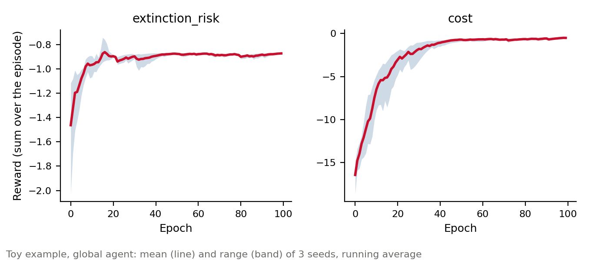
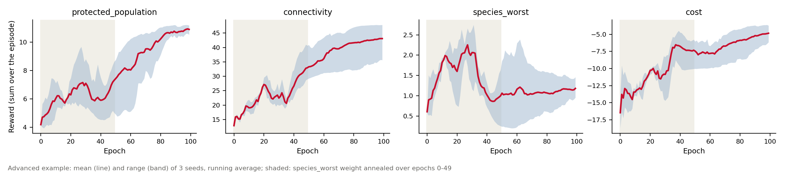

# Training Guide

CAPTAIN trains protection policies with Natural Evolution Strategies (ES), a
gradient-free optimizer: it perturbs the policy weights, runs one episode per
perturbation and moves the weights towards the perturbations that scored a higher
reward. It needs no gradients through the simulation, so any reward term can be used,
and episodes can run in parallel.

Runnable versions of everything below are in [`examples/`](../examples/): see the
[toy-example tutorial](../tutorials/toy_example/README.md) for the basic workflow and
the [advanced example](../tutorials/advanced_example/README.md) for edge effects,
connectivity and reward weight schedules.

## Training loop

```python
import captain as cn

runners = [create_episode_runner() for _ in range(n_workers)]  # cn.EpisodeRunner objects

trainer = cn.EvolStrategiesTrainer(
    runners,
    initial_coeffs=runners[0].policy.get_flat_weights(),
    scheduler=cn.LearningScheduler(initial_alpha=0.05, initial_sigma=0.3),
    n_perturbations=6,
    seed=123,
)
for epoch in range(n_epochs):
    avg_reward, summary = trainer.train_epoch()
trainer.close()
```

`cn.algorithms.TrainingLogger` writes one row per epoch (total and per-term rewards,
learning rate, sigma, protected cells, extinction-risk classes) and saves the weights
after each epoch.

## Update rule and advantage normalization

At each epoch the trainer draws `n_perturbations` noise vectors, evaluates
`weights + sigma * noise_i`, and updates

```
weights += alpha / (n * sigma) * sum_i(advantage_i * noise_i)
```

`advantage_normalization` sets how the perturbation rewards become advantages:

| Value | Advantage | Notes |
|---|---|---|
| `"zscore"` (default) | rewards standardized within the epoch | Step size depends on `alpha` and `sigma` only |
| `"rank"` | centred ranks of the rewards | Also robust to outlier episodes |
| `None` | reward minus a running baseline | Step size grows with the reward scale |

With `None`, the step size scales with the size of the rewards: reward calibration
typically multiplies the terms by 10-50x, which can make the first epochs unstable.
With `"zscore"` or `"rank"`, the reward weights and calibration still decide which
perturbations are better, but not how large a step is.

## Learning schedule

`cn.LearningScheduler` decays the learning rate (`alpha`) and the noise (`sigma`) each
epoch:

```python
scheduler = cn.LearningScheduler(
    initial_alpha=0.05,
    initial_sigma=0.3,
    alpha_decay=0.99,
    sigma_decay=0.99,
    min_alpha=0.0001,
    min_sigma=0.01,
)
```

It also adapts sigma to keep the plans of the perturbations about 80% similar
(Jaccard index of their protected cells): sigma shrinks while the plans disagree and
grows while they are almost identical. Sigma never goes below `min_sigma`. This
matters with standardized advantages, where the step scales as `alpha / sigma`: a
collapsing sigma would make steps much larger than the neighbourhood the perturbations
explored. `fixed_sigma=True` keeps sigma constant.

## Reward calibration

Reward terms can live on very different scales (e.g. a count of species changing
extinction-risk class vs. a share of the total cost).
`trainer.get_reward_calibrated_weights()` runs probe episodes and returns one
multiplier per term from the spread of its values; `save_reward_calibration` /
`load_reward_calibration` store them by term name. Calibrate against the single global
agent (see `examples/calibrate_rewards.py`), so that global and regional runs share
the same reward scale. Terms that are already fractions in `[0, 1]`
(`CalcRewardProtectedPopulation`, `CalcRewardWorstSpecies`, `CalcRewardConnectivity`,
`CalcRewardLayerOverlap`) usually need no calibration. See the
[rewards tutorial](../tutorials/rewards/README.md).

## Reward weight schedules

`cn.RewardWeightSchedule` changes the weight of chosen terms over the epochs, on top of
the reward weights and the calibration. A typical use is a term that gives no signal
for an untrained policy, such as `CalcRewardWorstSpecies` (0 while many species are
unprotected): start it with a large weight so the policy first learns to spread
protection, then lower it to its final weight:

```python
schedule = cn.RewardWeightSchedule(
    {"species_worst": cn.FactorSchedule(start=100.0, epochs=100)}  # 100x -> 1x, geometric
)
trainer = cn.EvolStrategiesTrainer(runners, weights, reward_weight_schedule=schedule)
```

`FactorSchedule(start, epochs, end=1.0, shape="geometric")` also supports
`shape="linear"`, and a factor can grow (`start < end`) to bring a term in late. The
multipliers of each epoch are sent with every episode, so all worker processes use
them, and `TrainingLogger` adds `mult_<term>` columns. While a schedule runs, the total
reward follows the changing weights: compare the per-term columns (`r_<term>`) across
epochs instead. See `examples/train_policy_weight_schedule.py` and
`examples/train_policy_advanced.py`.

## How long to train

[`scripts/convergence_study.py`](../scripts/convergence_study.py) trained two setups on the
data of the [toy-example tutorial](../tutorials/toy_example/README.md) (30 species, about
58,000 cells, 10% of them protected) for 100 epochs, with three seeds each, 6 perturbations
and 4 CPU workers (about 15 minutes per run on a laptop):

- **Global agent** ([`examples/train_policy.py`](../examples/train_policy.py)):
  extinction-risk and cost terms.
- **Advanced setup** ([`examples/train_policy_advanced.py`](../examples/train_policy_advanced.py)):
  edge effects, protected population, connectivity, cost, and the worst-served species,
  whose weight was annealed from 100x to 1x over the first 50 epochs.

The figures show each reward term summed over the 50 time steps of an episode, before
weights and calibration (line: mean of the three seeds' running averages; band: their
range). The tables give the mean reward of all perturbations in early, middle and late
epochs.



| Term | epochs 0-9 | epochs 40-49 | epochs 90-99 |
|---|---|---|---|
| extinction_risk | -1.04 | -0.87 | -0.87 |
| cost | -9.67 | -0.69 | -0.55 |

The global agent covered 90% of its total improvement by epoch 23 (extinction risk) and
epoch 28 (cost), and 95% by epoch 37. The three seeds ended within about 0.1 of each other.



| Term | epochs 0-9 | epochs 40-49 | epochs 90-99 |
|---|---|---|---|
| protected_population | 5.48 | 7.01 | 10.85 |
| connectivity | 18.04 | 33.32 | 43.01 |
| species_worst | 1.39 | 0.89 | 1.18 |
| cost | -13.70 | -7.48 | -4.83 |

In the advanced setup, the protected population stalled around 6-7 while the worst-served
term had a large weight (shaded). It rose again once that weight came down, and the
protected population, connectivity and cost covered 90% of their total improvement between
epochs 71 and 80, 20-30 epochs after the schedule ended. The
[advanced example](../tutorials/advanced_example/README.md)'s single run of 40 epochs, with
a 20-epoch schedule, ended at similar values (protected population 10.9, connectivity 39,
cost -4.9 over its last 10 epochs), so the longer schedule delayed the improvement rather
than adding to it. Seeds ended further apart than for the global agent, most of all in
connectivity (35 to 48 over the last 10 epochs).

As a rule of thumb:

- Without a weight schedule, on a problem the size of the toy data, train for about 40
  epochs. The 20 epochs of `train_policy.py` show training at work but stop before it
  levels off.
- With a weight schedule, train for the length of the schedule plus 30-40 epochs.
- Larger problems (more species, cells or reward terms) need more. Watch the per-term
  columns (`r_<term>`) of `training_log.tsv` and stop once their running averages have
  been flat for 10-20 epochs; a [checkpoint](#checkpoints) lets you extend a run that
  stopped too early.
- Before comparing two settings, train each with two or three seeds, and treat
  differences smaller than the spread between seeds as noise.

To repeat the study (about 1.5 hours; finished runs are skipped, `--plot` only redraws
the figures):

```bash
uv run python scripts/convergence_study.py
```

## Static single-step episodes

When habitat suitability, disturbance and costs are treated as fixed, a plan can be
optimized within a single time step:

```python
budget = cn.GlobalBudgetManager(
    total_target=n_cells_to_protect,
    cells_per_time_step=n_cells_to_protect,   # the whole budget in one time step
    feature_updates_per_time_step=20,         # in 20 decisions, features updated in between
)
runner = cn.EpisodeRunner(
    env=env, feature_extractor=extractor, policy_network=policy, rewards=rewards,
    budget_manager=budget, n_steps=1,
    env_dynamics=False,  # no dispersal/growth; disturbance, costs and SDMs stay fixed
)
```

With `env_dynamics=False` populations stay at their initial values, so rewards only
reflect which cells are protected, and episodes run much faster. The number of cells
protected per decision is rounded up, so the whole target is reached.

## CPU pool and GPU sequential mode

| Mode | Runners | `n_perturbations` | Execution |
|---|---|---|---|
| CPU pool | one per worker process | defaults to the number of runners | `multiprocessing.Pool` |
| GPU sequential | 1 | set explicitly | loop on the current process |

Passing a single runner evaluates the perturbations one after the other on the current
process, which avoids pickling CUDA tensors. The example scripts choose the mode from
`torch.cuda.is_available()`.

The pool uses the `forkserver` start method, so run training from a script file (as
the examples do), not from code piped into `python -`.

## Checkpoints

```python
trainer.save_checkpoint("checkpoint.npz")   # weights, running reward, scheduler, RNG, epoch
trainer.load_checkpoint("checkpoint.npz")   # resume exactly where training stopped
```

Checkpoints store the epoch counter, so a resumed run continues a reward weight
schedule, and the reward calibration.
