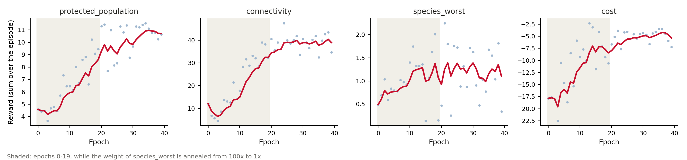
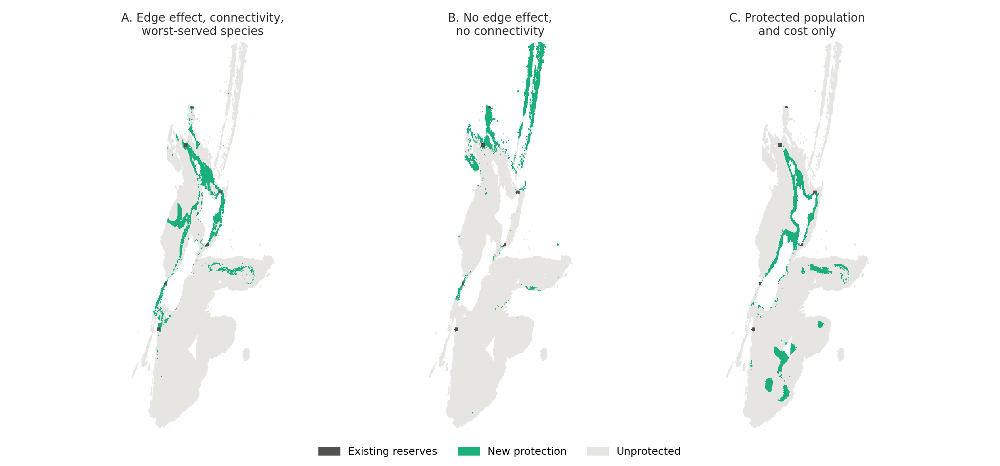
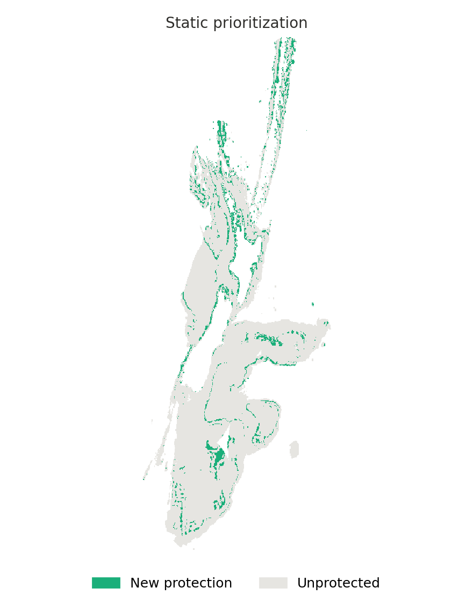

# Advanced Example: Edge Effects, Connectivity and Static Plans

This tutorial builds on the [toy-example walkthrough](../toy_example/README.md) and uses
the same toy dataset (30 species, ~58k valid cells). It shows the newer CAPTAIN features
in one run of [`examples/train_policy_advanced.py`](../../examples/train_policy_advanced.py):

- an **edge effect**: disturbance spills over from unprotected land into the borders of
  protected areas, so isolated cells and thin strips support smaller populations than
  the core of a compact reserve
- **existing protected areas** that the plan adds to
- **connectivity**: a reward for linking the existing protected areas with new protection
- **several objectives** on `[0, 1]` scales (no reward calibration needed), including a
  worst-served species term whose weight is annealed during training
- **export** of the plan as a KMZ file for Google Earth

The last section shows [`examples/static_prioritization.py`](../../examples/static_prioritization.py),
which optimizes a one-shot plan within a single time step, without population dynamics.

For the reward terms themselves, see the [rewards tutorial](../rewards/README.md); for
the optimizer settings, the [training guide](../../docs/training.md).

## 1. Running it

```bash
uv run python examples/train_policy_advanced.py
```

With the default settings (40 epochs, 6 perturbations, 4 CPU workers) this took about
6 minutes on a laptop. The results go to a folder named after the switches described
below, e.g. `data/advanced_edge0.9_conn_worst_p0.1/`:

| File | Content |
|---|---|
| `training_log.tsv` | One row per epoch: total and per-term rewards (`r_<term>`), weight multipliers (`mult_<term>`), learning rate, sigma, protected cells |
| `trained_weights.npy` | Policy weights |
| `reward_<term>_over_training.png` | Each reward term over the epochs |
| `protection_plan.png`, `.npy`, `.kmz` | The plan of the trained policy: map, grid (1 = existing, 2 = new protection) and Google Earth file |
| `training_plots/` | Protection maps during training (every `PLOT_TRAIN_FREQ` epochs) |

At the end the script runs the trained policy once and prints a summary of the plan:
protected patches (groups of 8-connected protected cells), isolated cells, and the final
value of each reward term.

## 2. What the script sets up

All settings are constants at the top of the script.

### Edge effect

```python
EDGE_FACTOR = 0.9           # 0 = no edge effect
EDGE_RADIUS = 1             # neighbourhood in cells (1 = the 8 surrounding cells)
EDGE_DECAY = None           # weight neighbours by exp(-distance / EDGE_DECAY)
EDGE_SOURCE = "unprotected"
```

These are passed to `cn.BioEnv(edge_factor=..., edge_radius=..., edge_decay=...,
edge_source=...)`. A protected cell receives `EDGE_FACTOR` times its edge exposure as
disturbance. With `EDGE_SOURCE = "unprotected"` the exposure is the unprotected share of
its neighbourhood: an isolated protected cell has exposure 1, a cell in the core of a
reserve 0. With `"disturbance"` it is the mean disturbance of the unprotected
neighbours, so edges facing undisturbed land cost nothing. See
[rewards tutorial §8](../rewards/README.md#8-rewards-and-the-edge-effect) for which
reward terms respond to the edge effect.

Two policy features let the policy see the edge effect: `"edge_exposure"` (the current
exposure of each cell) and `"buffer_value"` (how much habitat value protecting a cell
would shield in its protected neighbours). `"buffer_value"` needs a value per cell,
which the script computes from the species' carrying capacities, threat status and
sensitivity, and passes as `FeatureExtractor(..., cell_values=...)`.

### Existing protected areas

```python
EXISTING_PA_FILE = None     # raster of existing protected areas (> 0 = protected)
N_RESERVES = 6              # otherwise: stand-in reserves...
RESERVE_RADIUS = 3          # ...of 7 x 7 cells...
RESERVE_MIN_SEPARATION = 50 # ...at least 50 cells apart
```

The toy data has no layer of protected areas, so the script seeds 6 stand-in reserves
of 7 x 7 cells at the most species-rich cells of the largest connected part of the
study area. With real data, set `EXISTING_PA_FILE` to a raster of the existing protected
areas (relative to `DATA_DIR`).

The reserves go into the protection matrix when it is created:

```python
protection = cn.SpatialData(data=protection_grid, mask=mask, lower_bound=0, upper_bound=1)
```

`SpatialData` keeps a copy of its initial data and `env.reset()` restores it, so every
episode starts from the existing reserves. The budget adds
`TARGET_PROTECTED_CELLS_FRACTION` (10%) of the valid cells on top of them.

### Connectivity

```python
USE_CONNECTIVITY = True
CONN_RESISTANCE = "uniform"   # or "cost"
CONN_ALPHA = 40.0             # distance decay, in resistance units
CONN_AREA_EXPONENT = 0.5      # unit weight = area ** exponent
CONN_FEATURE_REFRESH = 5      # recompute the pa_linking feature every n decisions
```

`cn.PAConnectivity` treats each existing reserve as a unit and measures the gaps between
units as least-cost distances through unprotected cells. `CalcRewardConnectivity` rewards
the gain in Equivalent Connected Area, from 0 (the existing reserves) to 1 (all reserves
linked), and the `"pa_linking"` feature shows the policy which cells lie on the missing
links (see [rewards tutorial §6](../rewards/README.md#6-connectivity-calcrewardconnectivity)).

With `"uniform"` resistance the gap between two reserves is the number of cells needed to
link them. `"cost"` uses the cost layer relative to its mean, so links follow cheap land.
The cost layer of the toy data is very skewed (about half of the cells cost almost
nothing), which makes cost-based gaps short: their median is 19 resistance units, against
178 cells with uniform resistance. With `CONN_ALPHA = 40`, the existing reserves would
then count as 79% connected before any new protection (45% with uniform resistance),
leaving little for the reward to measure, so the script uses uniform resistance by
default. `CONN_ALPHA` should be set relative to the gaps: much larger than them, all
reserves count as connected; much smaller, no link pays off until it is complete.

### Rewards and the weight schedule

```python
REWARD_WEIGHTS = {"protected_population": 1.0, "species_worst": 1.0,
                  "connectivity": 1.0, "cost": 1.0}
THREAT_WEIGHTS = [1, 2, 4, 8, 16]   # LC, NT, VU, EN, CR
WORST_FRACTION = 0.1
WORST_WEIGHT_START = 100.0
```

| Term | Measures |
|---|---|
| `protected_population` | Protected share of each species' population, weighted by threat status |
| `connectivity` | ECA gain among the existing reserves |
| `species_worst` | Protected share of the 10% worst-served species |
| `cost` | Share of the total cost that is protected (a penalty) |

All four are on `[0, 1]` scales per time step, so the script needs no reward calibration.
`species_worst` is 0 while more than 10% of the species have no protection, which gives
an untrained policy no signal. Its weight therefore starts at 100x and is lowered
geometrically to 1x over the first half of the training with a reward weight schedule:

```python
schedule = cn.RewardWeightSchedule(
    {"species_worst": cn.FactorSchedule(start=WORST_WEIGHT_START, epochs=ANNEAL_EPOCHS)}
)
trainer = cn.EvolStrategiesTrainer(..., reward_weight_schedule=schedule)
```

`USE_CONNECTIVITY = False`, `USE_WORST_SPECIES = False` and `EDGE_FACTOR = 0` switch the
components off.

## 3. Results

The figures and the table below are made by
[`scripts/make_advanced_plots.py`](../../scripts/make_advanced_plots.py) from the trained
runs. They come from single runs of 40 epochs with one seed, so treat differences of a
few percent as run-to-run variation.

### Rewards over training



Each panel is one reward term, summed over the 50 time steps of an episode (dots: mean
of the epoch's perturbations; line: running average). Over the 40 epochs, the protected
population rose from 4.6 to about 10.7 and the connectivity from 12 to about 39, while
the cost penalty fell from -17.9 to about -5 (the plan moved to cheaper land). The
worst-served term rose while its weight was annealed (shaded), then stayed noisy around 1
(out of a possible 50), so the worst-served species remained poorly protected (see below).

The total reward is not plotted: while the weight of `species_worst` changes, it mixes
reward scales across epochs. Compare the per-term columns (`r_<term>`) of
`training_log.tsv` instead.

### Plans with and without the new components

The script was run three times:

- **A**: the default settings
- **B**: `EDGE_FACTOR = 0`, `USE_CONNECTIVITY = False`
- **C**: `EDGE_FACTOR = 0`, `USE_CONNECTIVITY = False`, `USE_WORST_SPECIES = False`
  (protected population and cost only)

Each plan adds 5,831 cells (10% of the valid cells) to the 232 cells of the 6 existing
reserves.



To compare the plans under the same conditions, each final plan was protected from the
first time step and simulated for 50 steps (with climate change) in the environment of
run A, with and without the edge effect:

| Run | Protected patches | Isolated cells | Connectivity (ECA gain) | Protected population | Loss to edge effect | Worst-served species | Cost |
|---|---|---|---|---|---|---|---|
| A | 133 | 66 | 0.78 | 19.9% | 4% | 0.5% | 12.8% |
| B | 159 | 62 | 0.13 | 11.5% | 5% | 0.3% | 1.4% |
| C | 91 | 39 | 0.53 | 21.0% | 2% | 0.1% | 26.7% |

Protected population is the threat-weighted mean of the protected share of each species'
population, worst-served species the mean protected share of the 3 worst-served species
(10% of 30), loss to edge effect the drop in protected population compared to the same
plan without the edge effect, and cost the mean share of the total cost that is
protected.

- **Connectivity.** Plan A links most of the existing reserves with corridors of new
  protection (ECA gain 0.78, where 1 = all reserves linked). Plan B leaves them isolated
  (0.13). Plan C reaches 0.53 without any connectivity reward, because its protection
  happens to follow the same stretch as some of the reserves.
- **Protected population and cost.** Linking the reserves cost plan A little protected
  population compared to C (19.9% vs 21.0%), and A is cheaper. Plan B is much cheaper
  still but protects less: with equal weights, protected population and cost trade off,
  and short runs end at different points of that trade-off.
- **Edge effect.** It costs these plans only 2-5% of their protected population, because
  most protected cells lie inside large blocks. In these runs, training with it did not
  make the plan more compact: plan A has more isolated cells than C, and its corridors
  are thin, so it loses a little more to edges. Connectivity and the edge effect pull in
  opposite directions, since corridors are mostly edge. The edge effect matters most
  where a plan would otherwise be scattered: in the test in
  [rewards tutorial §8](../rewards/README.md#8-rewards-and-the-edge-effect), scattered
  cells lost 51% of their protected population and compact blocks 15%.
- **Worst-served species.** In all three plans, the 3 worst-served species have less
  than 1% of their population protected: in these short runs the worst-served term did
  not lift them. A per-species target on `CalcRewardProtectedPopulation`, as in the
  static example below, is another way to spread protection across species.

### Viewing the plan in Google Earth

`protection_plan.kmz` in the results folder holds the plan as polygons, in two folders:
the existing reserves (grey) and the new protection (green). Open it in Google Earth or
QGIS to see the plan on satellite imagery. The script georeferences it like the species
distribution maps (see [`docs/inference.md`](../../docs/inference.md#exporting-plans-for-google-earth)).

## 4. Static prioritization

When habitat suitability, disturbance and costs are treated as fixed, a plan can be
optimized as a one-shot prioritization:

```bash
uv run python examples/static_prioritization.py
```

The script uses the present-day layers only and allocates the whole budget (10% of the
valid cells) within a single time step, in `N_DECISIONS = 20` decisions, with the policy
features recomputed between decisions, so later decisions can complement what is already
protected:

```python
budget_manager = cn.GlobalBudgetManager(
    total_target=target_protected_cells,
    cells_per_time_step=target_protected_cells,  # the whole budget in one time step
    feature_updates_per_time_step=N_DECISIONS,
)
runner = cn.EpisodeRunner(..., n_steps=1, budget_manager=budget_manager,
                          env_dynamics=False)  # no dispersal or growth
```

With `env_dynamics=False` populations stay at their initial values, so the rewards only
reflect which cells are protected, and an episode takes a fraction of a second: 40 epochs
took about 2 minutes. The rewards are `CalcRewardProtectedPopulation` with a per-species
target (`PROTECTION_TARGET = 0.1`: once 10% of a species' population is protected, more
protection of it earns nothing) and `CalcRewardPersistentCost`.



| Policy | Lowest protected share of a species | Median | Species with >= 10% protected | Share of the total cost |
|---|---|---|---|---|
| Untrained | 0.2% | 7.9% | 10 of 30 | about 14% |
| Trained | 6.1% | 10.8% | 25 of 30 | 2.1% |

The target spreads protection across species: the trained plan is made of many small
patches over the ranges of different species, rather than the blocks of the plans above.
Without dynamics there is no edge effect, so nothing penalizes scattered cells; add an
edge effect and a dynamic episode (as in `train_policy_advanced.py`) when reserve shape
matters.

## 5. Things to try

- `EDGE_SOURCE = "disturbance"`: edges facing undisturbed land cost nothing, so reserves
  can extend into low-disturbance areas without penalty.
- `EDGE_RADIUS = 3` with `EDGE_DECAY = 1.0`: the edge effect reaches deeper into a
  reserve and fades with distance from its border, which favours wider reserves.
- `CONN_RESISTANCE = "cost"` with a cost layer that is less skewed than the toy one.
- `EXISTING_PA_FILE`: plan around real protected areas.
- More epochs and perturbations: the runs above are short, and their plans still change
  from one epoch to the next.
